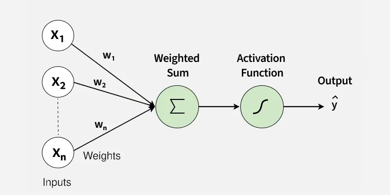
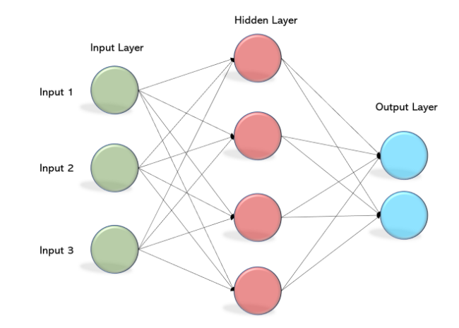

<h1>NNeural</h1>

artificial neurons, simplified in C

<h2>Overview</h2>

This library provides a set of functions and structs related to MLPs and perceptrons.

<h2>License</h2>

This project is licensed under the MIT License. See the <a href="LICENSE">LICENSE</a> file for details.

